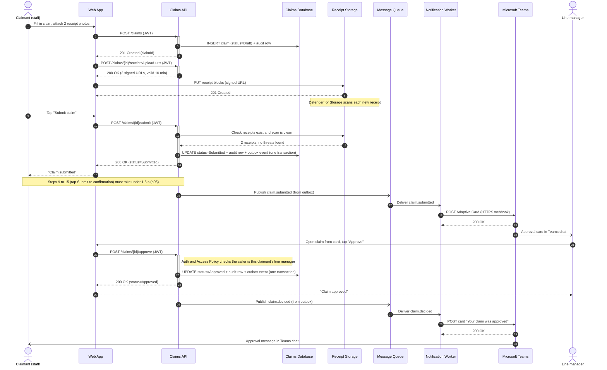
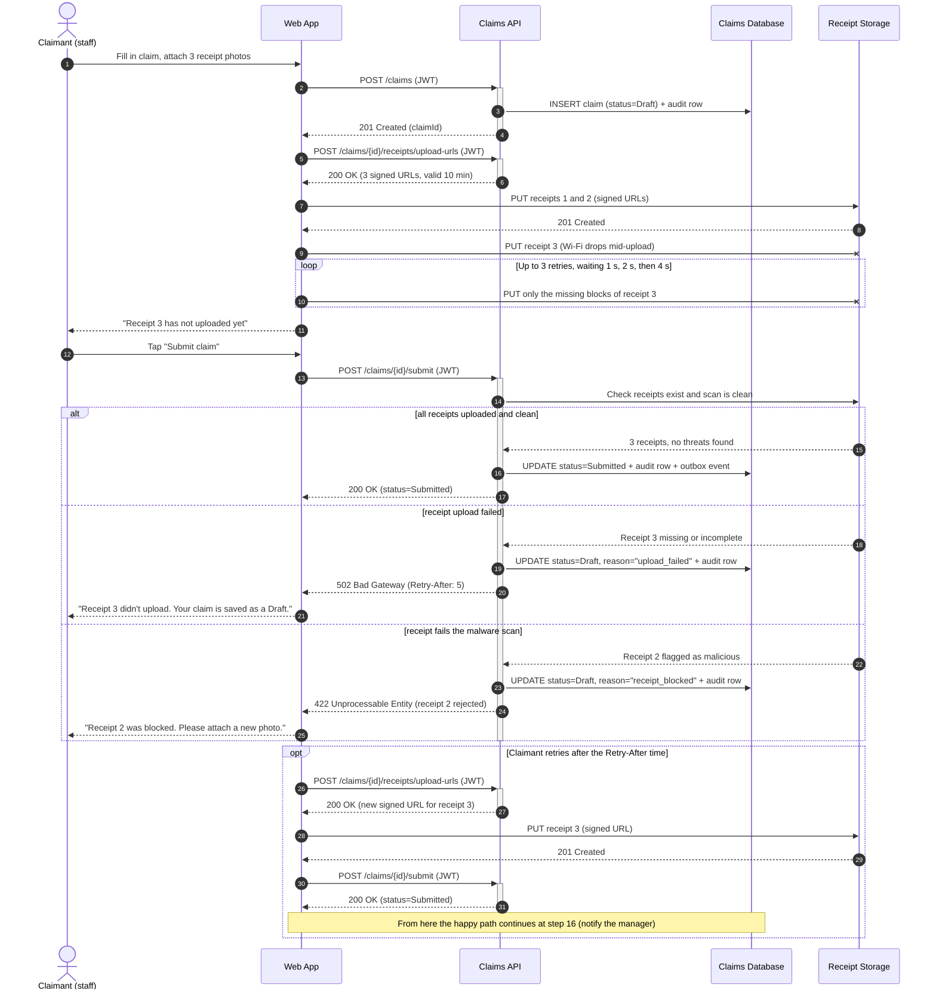

# Sequence — Submit and Approve a Claim

Day 4 — Deliverable 2

This diagram follows one claim through GreenChit over time. The lifelines use exactly the same names as the container diagram in `sajanikka-day4-greenchit-design.md`, so each lifeline can be matched to one box.

| Lifeline | Element in the architecture pack |
|----------|----------------------------------|
| Claimant (staff) | Person |
| Web App | Container: React SPA |
| Claims API | Container: ASP.NET Core 8 on App Service |
| Claims Database | Container: Azure SQL Database |
| Receipt Storage | Container: Azure Blob Storage |
| Message Queue | Container: Azure Service Bus |
| Notification Worker | Container: WebJob on App Service |
| Microsoft Teams | External system: Adaptive Card webhook |
| Line manager | Person |

**How to read the arrows**

| Arrow | Meaning | Example |
|-------|---------|---------|
| Solid line, filled arrowhead (`->>`) | **Synchronous** call: the caller waits for an answer | `POST /claims/{id}/submit` |
| Dashed line, filled arrowhead (`-->>`) | **Return** of a synchronous call | `200 OK` |
| Solid line, open arrowhead (`-)`) | **Asynchronous** message: the sender does not wait | `Publish claim.submitted` |
| Line ending in a cross (`-x`) | A call that **failed** | Upload interrupted |

Tall thin bars on a lifeline (activation bars) show when the Claims API is working on a request.

**One difference from the brief's starting example:** in this design the browser uploads receipts **straight to Receipt Storage** with signed URLs, before the claim is submitted, rather than the API uploading them. That keeps 10 MB files out of the API and lets an interrupted upload resume (see the container diagram). So a claim is first created as a **Draft**, and only becomes **Submitted** once its receipts are confirmed.

## Happy path

**What happens, in order**

1. **Create as Draft (steps 1–4).** The Web App creates the claim. The API saves it as **Draft** and writes the first audit row.
2. **Upload receipts (steps 5–8).** The API hands out short-lived signed URLs, and the browser uploads the photos directly to Receipt Storage. Defender for Storage scans each one.
3. **Submit (steps 9–15).** The API confirms the receipts exist and are clean, then changes the status to **Submitted**. The status change, its audit row and the "claim submitted" event are saved in **one database transaction**, so none of them can be lost without the others. The claimant sees "Claim submitted" right away.
4. **Notify the manager (steps 16–20), asynchronously.** The event goes through the Message Queue to the Notification Worker, which posts an Adaptive Card to Teams. The claimant never waits for this part, which keeps submission under 1.5 seconds.
5. **Approve (steps 21–25).** The manager opens the claim and approves it. The API checks the manager is allowed to approve this claim, saves **Approved** with an audit row, and answers `200 OK`.
6. **Tell the claimant (steps 26–30),** again asynchronously through the queue and Teams.

## Error path — receipt upload fails after the claim was created

**What happens, in order**

1. **The claim already exists (steps 1–6).** It was created as a Draft, so nothing the claimant typed is lost when the upload fails.
2. **The upload is interrupted (steps 7–11).** The connection drops while receipt 3 is uploading. The Web App retries **only the missing blocks**, up to 3 times with growing waits (1 s, 2 s, 4 s), and tells the claimant it hasn't finished yet.
3. **Submit is checked (steps 12–14).** When the claimant taps Submit, the API asks Receipt Storage whether every receipt is there and clean. The `alt` fragment shows the three possible answers:
   - **All uploaded and clean:** normal submission, as in the happy path.
   - **Upload failed:** the claim stays **Draft** with `reason="upload_failed"`, an audit row records it, and the API returns `502 Bad Gateway` with `Retry-After: 5`, matching the error contract in the brief.
   - **Malware found:** the claim stays **Draft** with `reason="receipt_blocked"`, and the API returns `422`, because retrying the same file will not help: the claimant must attach a new photo.
4. **Recovery (`opt` fragment).** After the Retry-After time, the Web App asks for a new signed URL (the old one may have expired), uploads receipt 3, and submits again. The flow then joins the happy path at step 16.

## Exported images

The required export, with both paths in one image:

The same two diagrams exported separately from Mermaid Chart, which confirms both blocks above render without syntax errors:

| File | Content |
|------|---------|
| `sequence-happy-path.png` | Happy path, steps 1–30 |
| `sequence-error-path.png` | Error path, steps 1–31, with the `loop`, `alt` and `opt` fragments |
